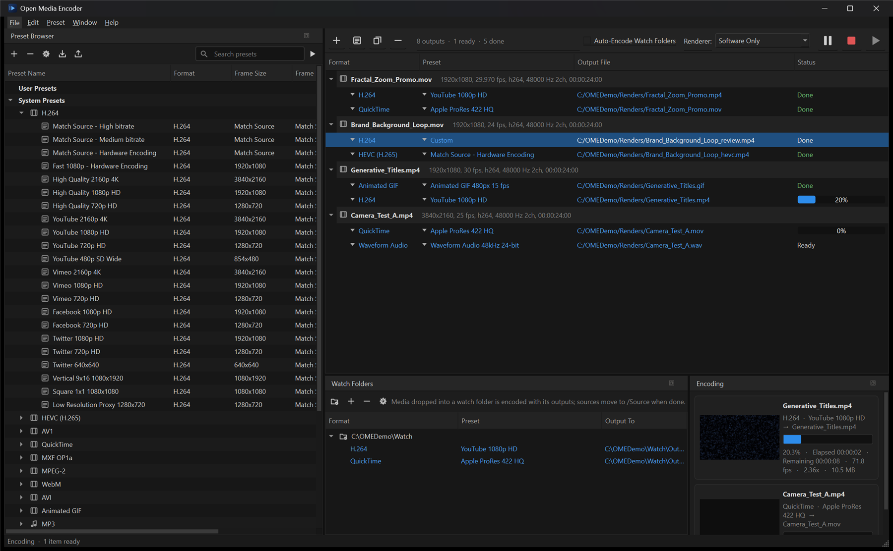
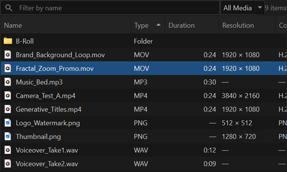
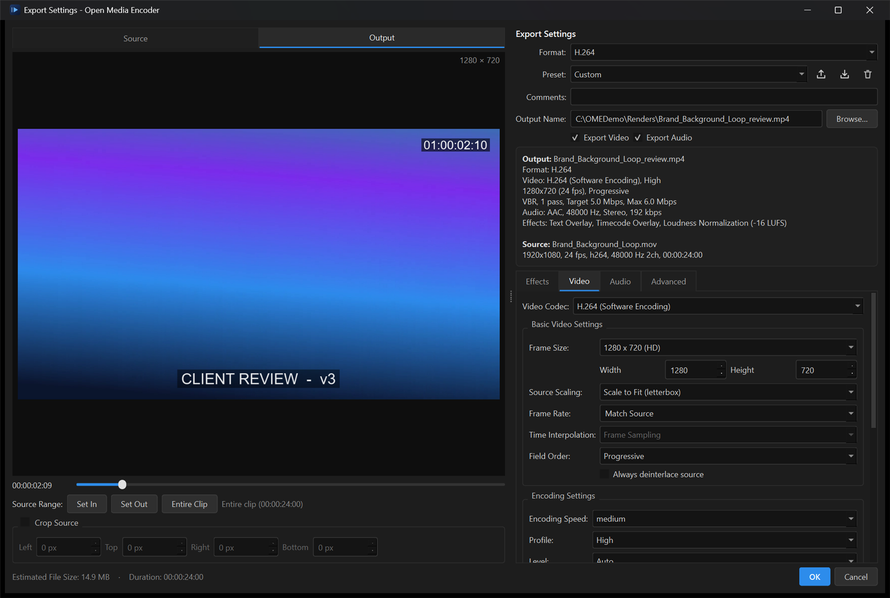
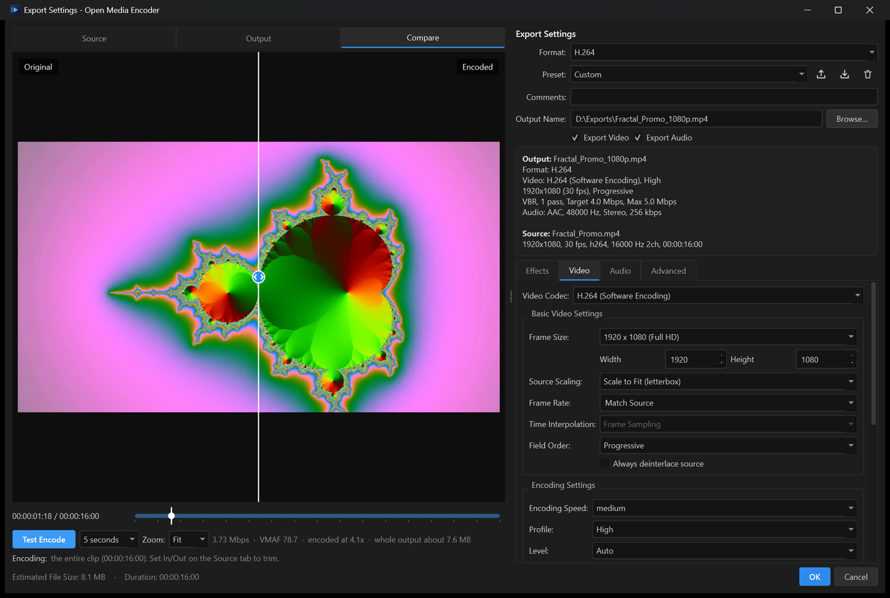
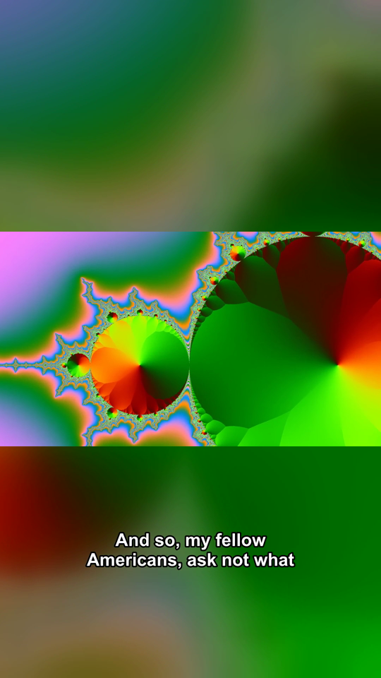

<p align="center">
  
</p>

<h1 align="center">Open Media Encoder</h1>

<p align="center">
  <strong>A free alternative to Adobe Media Encoder, with extra features.</strong><br>
  Open source, for Windows and Linux, built on Qt 6 and FFmpeg.
</p>

<p align="center">
  Queue up your media, pick presets, add LUTs, overlays and loudness normalization, and encode
  to H.264, HEVC, AV1, ProRes, DNxHR and more, with GPU acceleration.<br>
  Then go further: hit an exact file size or quality score, compare before and after, cut out
  silences and "um"s, caption speech automatically (all offline), and record live streams.
</p>

<p align="center">
  <a href="https://github.com/glenwrhodes/open-media-encoder/actions/workflows/build.yml"></a>
  <a href="https://github.com/glenwrhodes/open-media-encoder/releases/latest"></a>
  <a href="LICENSE"></a>
  
  <a href="CONTRIBUTING.md"></a>
</p>

<p align="center">
  
</p>

## What is it?

**If you've used Adobe Media Encoder, you already know how this works.** It's a full desktop
encoding app built around the same workflow: a batch queue where each source can have several
outputs, a preset browser, watch folders, and an Export Settings window with a live preview,
In/Out points, effects and every codec setting. It is not a thin FFmpeg wrapper: you never type a
command, and FFmpeg simply does the encoding underneath.

| The Media Encoder workflow you know | Plus extras |
| --- | --- |
| Batch queue with several outputs per source, pause, resume and parallel encodes | **Target file size**: "keep it under 10 MB for Discord" |
| 125+ presets: YouTube, TikTok, Instagram, ProRes, DNxHR, H.264, HEVC, AV1... | **Target quality**: pick a VMAF score instead of guessing a bitrate |
| Watch folders that encode whatever lands in them | **Compare** a test encode with the original, side by side |
| Export Settings with live preview, In/Out, crop, LUTs, overlays, timecode, captions | **Automatic captions** from speech, offline |
| Loudness normalization, broadcast limiter, image sequences, stitching clips | **Remove silence and filler words** from narration |
| GPU encoding (NVIDIA, Intel, AMD, VA-API) | **Vertical video** with a blurred background instead of black bars |
| Command line for scripts and render farms | **Stream Recorder**: save YouTube, Twitch and other live streams |

And it's free, open source (MIT) and runs on Linux as well as Windows.

---

## Download

**[⬇ Download the latest release](https://github.com/glenwrhodes/open-media-encoder/releases/latest)**

| Package | Use it if… |
| --- | --- |
| `OpenMediaEncoder-x.y.z-win64-setup.exe` | You want a normal install with a Start menu entry and an uninstaller. |
| `OpenMediaEncoder-x.y.z-win64-portable.zip` | You want to unzip and run without installing (USB stick, locked-down PC). |
| `OpenMediaEncoder-x.y.z-x86_64.AppImage` | You're on Linux: `chmod +x` the file and run it. |
| `OpenMediaEncoder-x.y.z-linux-x86_64.tar.gz` | You're on Linux without FUSE (some containers): extract and run `open-media-encoder`. |

Everything is included, **FFmpeg and whisper.cpp too**, so there is nothing else to install.

- **Windows:** 64-bit Windows 10 or 11. GPU encoding needs NVIDIA driver 570 or newer (NVENC), a
  recent Intel graphics driver (Quick Sync) or an AMD driver (AMF).
- **Linux:** 64-bit x86 with glibc 2.35 or newer (Ubuntu 22.04, Debian 12, Fedora 36, Linux Mint
  21 or newer). GPU encoding uses VA-API (Intel and AMD with Mesa drivers), NVENC (NVIDIA
  proprietary driver) or Quick Sync. Runs on X11 and on Wayland through XWayland.

The app detects what your machine supports and falls back to software encoding automatically.

> Windows SmartScreen may warn about a new, unsigned app. Choose **More info → Run anyway**.
> Every release lists SHA-256 checksums so you can verify the download.

## Features

**Batch queue**
- Several outputs per source: one clip can become a YouTube upload, a ProRes master and an audio stem in one pass.
- Drag files in from Explorer or the built-in Media Browser; drag presets onto sources.
- Start, pause (suspends the encoder), resume and stop. Run encodes in parallel. The queue is restored on the next launch.
- Stitch clips together into one output, or turn a still image into a video.
- Convert **image sequences** (PNG, EXR, DPX, TIFF, JPEG, …) to any format: pick any frame and the
  whole numbered sequence is detected. Alpha is kept for ProRes 4444 and similar.
- Reorder sources to set priority (Ctrl+Up / Ctrl+Down).
- Overall progress and time remaining appear in the status bar and on the Windows taskbar button.
- The computer stays awake while encoding, and can optionally sleep or shut down when the queue finishes.

**Media Browser**



- Click any column to sort. Sort by **Type** to group every MP4 together, every WAV together, and so on.
- Right-click the header to add columns: Kind, Duration, Resolution, Frame Rate, Codec, Audio,
  Bitrate and Date Created. Media details are read in the background.
- Filter by name or by Video / Audio / Images, keep favorite folders, and browse with Enter and Backspace.
- Right-click files to add them with a specific preset, stitch them, play them or reveal them in Explorer.

**Export settings with a live preview**



- Source/Output preview rendered through the real filter graph. Set In/Out (I/O keys) and crop on
  the Source tab; the Output tab scrubs exactly the range that will be encoded.
- Frame size with fit, fill, stretch or **blurred background** scaling; frame-rate conversion (sampling, blending, optical flow); field order and deinterlacing.
- Codec controls: speed preset, profile, level, pixel format, CBR / VBR 1-pass / VBR 2-pass / constant quality / target file size / target VMAF, keyframe distance.
- Audio codec, sample rate, channels and bitrate, plus an estimated file size and the exact FFmpeg command it will run.

**Smart encoding**



- **Target file size:** "Keep it under 10 MB for Discord" or "25 MB for email". The bitrate is
  worked out from the length and encoded in two passes; if the file still comes out too big, it's
  encoded again a little lower. Presets for Discord, WhatsApp and email are included.
- **Target quality (VMAF):** pick a score instead of a bitrate, e.g. 95 ("looks the same as the
  source"). Short test encodes spread through the clip are measured with
  [VMAF](https://github.com/Netflix/vmaf), Netflix's perceptual quality metric, to find the
  smallest file that still reaches it. Works with software and GPU encoders.
- **Compare before and after:** the Compare tab encodes a few seconds from the playhead with your
  settings and shows them next to the original. Drag the divider, zoom to 100–400% to see
  compression detail, and read the test's bitrate, VMAF score and projected file size.

**Vertical video with a blurred background**



- Fit the whole picture into a different shape (a landscape clip as a 9:16 Short or Reel, or a
  vertical phone video in a 16:9 frame) and fill the rest with a blurred, darkened copy of it
  instead of black bars or cropping. Blur strength and darkening are adjustable.
- Ready-made presets for YouTube Shorts, TikTok, Instagram Reels, square feeds and 16:9.

**Automatic captions**
- Speech becomes captions on your computer with [whisper.cpp](https://github.com/ggml-org/whisper.cpp);
  nothing is uploaded. Save an `.srt` next to the output, add a subtitle track viewers can turn on
  (MP4, MOV, WebM), and/or burn the captions into the picture, sized for the frame.
- Detects the spoken language (or pick one of 28), and can translate to English.
- The speech model (82 MB to 574 MB, your choice in Preferences) downloads once, on first use.

**Remove silence and filler words**
- Cuts the pauses out of talks, tutorials, screen recordings and podcasts, from video and audio
  together and frame-accurately. Set how quiet counts as silence, the shortest pause to cut, and how
  much breathing room to keep around speech.
- Optionally removes **filler words** too: "um", "uh", "er", "hmm" and any others you list. Speech
  recognition (whisper.cpp, with word timings) finds them, and the audio itself gives the exact cut
  points. Only fillers said on their own are cut, so a filler that runs into a real word is left in
  rather than clipping the word.

**Effects**
- 3D LUTs (`.cube`, `.3dl`), image overlay / watermark, text overlay, timecode burn-in.
- Broadcast-safe video limiter.
- Loudness normalization to EBU R128, ATSC A/85, streaming or podcast targets.
- Burned-in captions from `.srt`, `.ass` or `.vtt` files (or generated from the speech, as above).

**Formats and presets**

| Category | Formats |
| --- | --- |
| Delivery | H.264, HEVC (H.265), AV1, VP9/VP8 (WebM), MPEG-2, AVI, Animated GIF |
| Mastering | Apple ProRes 422 Proxy → 4444 XQ (with alpha), Avid DNxHR LB → 444, GoPro CineForm, QuickTime Animation, MXF OP1a |
| GPU encoders | NVIDIA NVENC, Intel Quick Sync, AMD AMF, VA-API on Linux, Apple VideoToolbox (each tested on your machine at startup) |
| Audio | AAC, MP3, WAV, AIFF, FLAC, Opus, AC-3 |
| Stills | PNG, JPEG, TIFF, DPX, BMP and Targa, as single frames or sequences |

**Web & Social presets** for YouTube (4K to 480p, Shorts), Vimeo, TikTok, Instagram (Reels,
Stories, feed), Facebook, X, LinkedIn, Snapchat and Pinterest follow each platform's recommended
settings. Drag a movie into the queue, drop "YouTube 720p HD" on it, and press Start. Vertical
presets crop landscape footage to fill (or use the Blurred Background variants), and bitrates rise
automatically for 60 fps sources. **Fit to File Size** presets keep uploads under Discord, WhatsApp
and email limits.

Altogether there are 125+ presets, including ProRes/DNxHR mastering, GPU encoding, "Visually
Transparent (VMAF 95)" and a silence-removing podcast preset. You can save, import and share your
own presets as JSON files.

**Stream Recorder**
- Paste a link to a live stream and press **Record**. It saves the stream to disk as it plays.
- **YouTube and Twitch** pages work directly: paste the watch page (or a channel's `/live` link)
  and the stream behind it is found for you. This uses the free
  [yt-dlp](https://github.com/yt-dlp/yt-dlp) helper, which the app downloads on first use and keeps up to date.
- Direct stream links work too: HLS (`.m3u8`), DASH, RTMP, RTSP IP cameras, SRT, UDP and internet radio.
- The stream is copied as is, with no re-encoding or quality loss, into MP4, MKV or MPEG-TS. MP4
  recordings are crash-safe: they're written as MKV and converted when the recording ends.
- Stop after a set time or record until stopped. If the stream drops, it reconnects and continues
  in a new part. Record several streams at once while the queue keeps encoding.
- DRM-protected streams (Netflix and similar) can't be recorded. Only record streams you have the
  right to save, and respect each site's terms.

**GPU acceleration, everywhere it helps**

| Work | GPU used |
| --- | --- |
| Encoding H.264, HEVC and AV1 | NVIDIA NVENC, Intel Quick Sync, AMD AMF, Apple VideoToolbox, VA-API on Linux. Built-in presets switch to the GPU automatically when one works on your machine (Preferences > Encoding). |
| Decoding the source | Hardware decoding through FFmpeg (`-hwaccel auto`), on by default |
| Captions and filler-word removal | NVIDIA GPUs on Windows (optional CUDA download, about 5x faster), Vulkan on Linux (NVIDIA, AMD, Intel), Metal on Apple silicon |

Everything falls back to the processor when no suitable GPU is found. Each GPU encoder is tested
on your machine at startup, and the log notes when speech recognition ran on the GPU.

**Automation**
- **Watch folders:** drop files into a folder and they are encoded automatically into `Output/`, and the source moves to `Source/`.
- **Command line:** headless encoding for scripts and render farms (see below).
- An encoding log and an error log record the full FFmpeg command and output for every job.

## Command line

```powershell
OpenMediaEncoder.exe --list-presets
OpenMediaEncoder.exe --preset "H.264/YouTube 1080p HD" -o out.mp4 input.mov
OpenMediaEncoder.exe --preset "sys/quicktime/Apple ProRes 422 HQ" -o D:\masters clip1.mp4 clip2.mp4
OpenMediaEncoder.exe --preset "HEVC/HD 1080p" --in 10 --out 25 -o excerpt.mp4 input.mov
OpenMediaEncoder.exe --preset "H.264/Match Source - High bitrate" --stitch -o reel.mp4 a.mov b.mov c.mov
OpenMediaEncoder.exe --preset "TikTok 1080x1920" --sequence --fps 30 -o title.mp4 renders\title_0001.png
```

Smart encoding options work on top of any preset:

```powershell
OpenMediaEncoder.exe --preset "H.264/Match Source - High bitrate" --target-size 10 -o clip-for-discord.mp4 clip.mov
OpenMediaEncoder.exe --preset "HEVC/HD 1080p" --target-vmaf 95 -o archive.mp4 input.mov
OpenMediaEncoder.exe --preset "YouTube 1080p HD" --remove-silence --captions srt,embed -o lesson.mp4 lesson.mov
OpenMediaEncoder.exe --preset "YouTube 1080p HD" --remove-fillers -o narration.mp4 narration.mov
OpenMediaEncoder.exe --preset "YouTube Shorts 1080x1920" --size 1080x1920 --scale blur --captions burn -o short.mp4 talk.mp4
```

`--captions` takes any of `srt`, `embed` and `burn`; add `--language fr` to set the spoken language
or `--translate` for English captions. The speech model is downloaded the first time it's needed.

Record a live stream (Ctrl+C stops it and keeps what was recorded):

```powershell
OpenMediaEncoder.exe --record "https://www.youtube.com/@SomeChannel/live" --duration 3600 -o D:\Recordings
OpenMediaEncoder.exe --record "rtsp://192.168.1.20/stream1" --format mkv -o porch-camera.mkv
```

Run `--record` from Windows Task Scheduler to record a stream at a set time.

Run with no `--preset` to open the app with the given files queued. The exit code is `0` on
success and `1` if any encode failed.

## Building from source

### Windows

**Prerequisites:** Windows 10/11 x64, [Qt 6.5+](https://www.qt.io/download-qt-installer) with the
MinGW 64-bit kit (or MSVC 2022), CMake 3.21+ and Ninja. The Qt online installer can install
CMake, Ninja and MinGW for you.

```powershell
git clone https://github.com/glenwrhodes/open-media-encoder.git
cd open-media-encoder
.\build.ps1 -Test                 # downloads the pinned FFmpeg and whisper.cpp, builds, runs the tests
.\build\OpenMediaEncoder.exe
```

`build.ps1` assumes Qt is installed at `C:\Qt\6.10.2\mingw_64`; pass `-QtDir` / `-ToolsDir` to
change that. `.\build.ps1 -Package -Installer` produces the same zip and installer as the
release pipeline (the installer needs [Inno Setup 6](https://jrsoftware.org/isinfo.php)).

<details>
<summary>Using CMake directly (e.g. with MSVC)</summary>

```powershell
.\scripts\fetch-ffmpeg.ps1
.\scripts\fetch-whisper.ps1
cmake -S . -B build -G Ninja -DCMAKE_BUILD_TYPE=Release -DCMAKE_PREFIX_PATH=C:\Qt\6.10.2\msvc2022_64
cmake --build build
ctest --test-dir build --output-on-failure
```
Run these from a *Developer PowerShell for VS 2022*. Qt Creator also opens `CMakeLists.txt` directly.
</details>

### Linux

**Prerequisites:** Qt 6.5+ (the [Qt online installer](https://www.qt.io/download-qt-installer) or
`pip install aqtinstall && aqt install-qt linux desktop 6.10.2 linux_gcc_64`), CMake 3.21+, Ninja
and a C++17 compiler. On Ubuntu/Debian: `sudo apt install build-essential ninja-build libgl1-mesa-dev libxkbcommon-x11-0 libxcb-cursor0`.

```bash
./scripts/fetch-ffmpeg.sh            # pinned static FFmpeg 8.0.1, verified by SHA-256
./scripts/fetch-whisper.sh           # builds the pinned whisper.cpp (speech to text) from source
./scripts/fetch-test-data.sh         # optional: small speech model for the captions test
cmake -S . -B build -G Ninja -DCMAKE_BUILD_TYPE=Release -DCMAKE_PREFIX_PATH=~/Qt/6.10.2/gcc_64
cmake --build build
QT_QPA_PLATFORM=offscreen ctest --test-dir build --output-on-failure
./build/OpenMediaEncoder
./scripts/package-linux.sh build dist   # AppImage and .tar.gz, as released
```

### macOS

The code builds and the test suite passes on macOS (CI checks every change), but there is no
signed package yet. To try it: `brew install qt ninja`, then the same commands as Linux
(`scripts/fetch-ffmpeg.sh` fetches a pinned FFmpeg 8.0.1 for Apple silicon or Intel, and
`scripts/fetch-whisper.sh` builds whisper.cpp with Metal); the app is `build/Open Media Encoder.app`.

## How it works

```
src/core   UI-free engine: format/codec registry, export settings, ffprobe probing, the FFmpeg
           command builder (filter graphs, rate control, two-pass), presets, queue model,
           encoding engine (with silence, VMAF and speech-to-text steps), watch folders,
           stream recorder
src/ui     Qt Widgets front end: main window and panels, Export Settings dialog, preferences
tests      Integration tests that run real encodes through FFmpeg for every preset and effect
scripts    FFmpeg and whisper.cpp fetch (pinned + checksummed) and packaging
installer  Inno Setup script for the Windows installer
```

The core library has no widget dependencies, which keeps it easy to test and to reuse (for
example in a future macOS/Linux front end or a server). See [CONTRIBUTING.md](CONTRIBUTING.md#architecture)
for a guided tour.

## Roadmap

Help is welcome on any of these. See [CONTRIBUTING.md](CONTRIBUTING.md) to get started.

- [x] Linux builds (AppImage)
- [ ] macOS package: signed and notarized `.dmg` (the code already builds and passes tests on macOS)
- [ ] Linux on ARM64 and Flatpak/Flathub packaging
- [ ] HDR: HDR10 / HLG metadata passthrough and tone mapping
- [ ] Audio channel mapping and multi-track audio export
- [ ] Proxy-workflow inputs
- [ ] Scheduled recordings in the app (the command line can already be scheduled)
- [ ] Publish destinations (upload to YouTube, Vimeo, S3, FTP after encoding)
- [ ] Translations (wrap UI strings in `tr()` and add Qt Linguist catalogues)
- [ ] More presets: broadcast delivery specs, archival, platform updates

## Contributing

Contributions of every size are welcome: bug reports, presets, docs, translations and code.

- Read the [contributing guide](CONTRIBUTING.md) for setup, architecture and conventions.
- Browse [open issues](https://github.com/glenwrhodes/open-media-encoder/issues), especially those labelled
  `good first issue`.
- Ask questions and share ideas in [Discussions](https://github.com/glenwrhodes/open-media-encoder/discussions).

Everyone taking part is expected to follow the [Code of Conduct](CODE_OF_CONDUCT.md).
Security issues: please see [SECURITY.md](SECURITY.md).

## License

Open Media Encoder is [MIT licensed](LICENSE). Release packages bundle FFmpeg (GPLv3), Qt
(LGPLv3) and whisper.cpp (MIT) as separate components; see [THIRD_PARTY_NOTICES.md](THIRD_PARTY_NOTICES.md).

Open Media Encoder is an independent project. It is not affiliated with or endorsed by Adobe
Inc.; Adobe and Media Encoder are trademarks of Adobe Inc. FFmpeg is a trademark of Fabrice Bellard.
